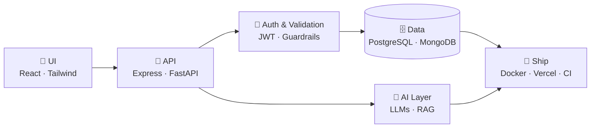

<!-- ═════════════════════════════  HERO  ═════════════════════════════ -->

  

  

  
  
  
  

---

## 👋 Hey, I'm Sumit

I'm a **Full Stack Developer** and final-year **Computer Science** student at **DYPCET, Kolhapur**. I like owning a feature end to end: designing the UI, writing the API behind it, modelling the data, and getting it live.

Lately I've been building **AI-powered web apps**, where an LLM does the heavy lifting but the surrounding engineering (auth, validation, guardrails, grounding) is what keeps it **reliable and safe** for real users.

- 🧩 **Build:** responsive React frontends + REST APIs with Node/Express & FastAPI
- 🛡️ **Care about:** security, clean architecture and code that's easy to maintain
- 🌱 **Learning:** system design, scalable backends and production LLM patterns
- 🎯 **Looking for:** Full Stack / Software Engineering internships & new-grad roles
- 🎓 **Graduating:** May 2027

---

## 🏗️ How I Build

---

## 🧰 Tech Stack

<table>
<tr><td align="center" width="140"><b>Languages</b></td>
<td></td></tr>
<tr><td align="center"><b>Frontend</b></td>
<td></td></tr>
<tr><td align="center"><b>Backend</b></td>
<td></td></tr>
<tr><td align="center"><b>Databases</b></td>
<td></td></tr>
<tr><td align="center"><b>DevOps & Tools</b></td>
<td></td></tr>
</table>

**AI Integration:** `LLM APIs` · `Gemini` · `RAG` · `Vector Search` · `Prompt Engineering`

---

## 🚀 Featured Projects

### 📚 StudyMate AI: RAG-Powered Study Tutor

> An AI tutor that answers **only from a student's own uploaded notes**, with citations, then quizzes them and tracks which topics are still weak.

| Layer | What I built |
| :-- | :-- |
| 🎨 **Frontend** | React SPA for uploading notes, chatting with the tutor and taking quizzes |
| 🔌 **Backend** | Node.js + Express REST API with JWT authentication |
| 🧠 **AI / Retrieval** | Gemini embeddings + MongoDB Atlas Vector Search; answers grounded in uploaded notes with source citations |
| 📝 **Learning loop** | AI-generated quizzes, server-side grading and a weak-topic dashboard |
| 💳 **Payments** | Stripe subscription billing wired through webhooks |

 

### 🛡️ SafeSQL: Text-to-SQL with Guardrails & Hallucination Detection

> Ask a database questions in **plain English**. SafeSQL writes the SQL, but a layered safety stack makes sure it can't destroy data, leak other users' rows, or pass off a hallucinated answer as fact.

| Layer | What I built |
| :-- | :-- |
| 💬 **NL → SQL** | Schema-aware prompting that turns plain-English questions into SQL over any PostgreSQL schema |
| 🔒 **Guardrails** | 4-layer safety stack: LLM refusal → AST query blocking (sqlglot) → read-only DB roles → per-user Row-Level Security |
| 🧪 **Hallucination detection** | Validates generated SQL against the real schema and uses calibrated confidence scoring to flag unreliable answers |
| 👤 **Multi-user** | Per-user login with user-scoped data access |
| ⚙️ **Backend** | FastAPI service, containerised with Docker |

---

## 🎓 Education

<table>
<tr>
<td>🏛️</td>
<td>
<b>D.Y. Patil College of Engineering and Technology, Kolhapur</b> 
B.Tech in Computer Science & Engineering · <i>Expected May 2027</i> · <b>CGPA 7.34 / 10</b> (till Sem 5) 
Coursework: DSA · DBMS (SQL & NoSQL) · Computer Networks · Web Technologies · Software Engineering · Operating Systems
</td>
</tr>
</table>

## 🏅 Certifications

- 🧠 **Certificate of Training Completion in AI**, Deloitte Solutions Pvt. Ltd. · *Jun – Jul 2026*
- 📈 **Data Science Virtual Internship (8 weeks)**, AICTE · EduSkills
- 🐍 **Complete Python with DSA Bootcamp**, Udemy

---

## 📊 GitHub Stats

  
  

  

  

---

  <b>💬 Let's build something together.</b> 
  Have an internship, a project or just a question? My inbox is open: <a href="mailto:Shendagesumit22@gmail.com">Shendagesumit22@gmail.com</a>

  

